# Домашнее задание к занятию «Оркестрация группой Docker контейнеров на примере Docker Compose» - `Шичков Евгений`


### Инструкция по выполнению домашнего задания

   1. Сделайте `fork` данного репозитория к себе в Github и переименуйте его по названию или номеру занятия, например, https://github.com/имя-вашего-репозитория/git-hw или  https://github.com/имя-вашего-репозитория/7-1-ansible-hw).
   2. Выполните клонирование данного репозитория к себе на ПК с помощью команды `git clone`.
   3. Выполните домашнее задание и заполните у себя локально этот файл README.md:
      - впишите вверху название занятия и вашу фамилию и имя
      - в каждом задании добавьте решение в требуемом виде (текст/код/скриншоты/ссылка)
      - для корректного добавления скриншотов воспользуйтесь [инструкцией "Как вставить скриншот в шаблон с решением](https://github.com/netology-code/sys-pattern-homework/blob/main/screen-instruction.md)
      - при оформлении используйте возможности языка разметки md (коротко об этом можно посмотреть в [инструкции  по MarkDown](https://github.com/netology-code/sys-pattern-homework/blob/main/md-instruction.md))
   4. После завершения работы над домашним заданием сделайте коммит (`git commit -m "comment"`) и отправьте его на Github (`git push origin`);
   5. В личном кабинете прикрепите и отправьте ссылку на решение в виде md-файла в вашем Github.
   6. Любые вопросы по выполнению заданий спрашивайте в разделе “Вопросы по заданию” в личном кабинете.
   
Желаем успехов в выполнении домашнего задания!
   
### Дополнительные материалы, которые могут быть полезны для выполнения задания

1. [Руководство по оформлению Markdown файлов](https://gist.github.com/Jekins/2bf2d0638163f1294637#Code)

---

## Задание 1. 
 Выполнил установку Docker и Docker Compose
  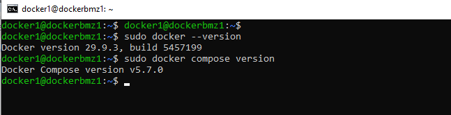
  Установка и заливка образа 
  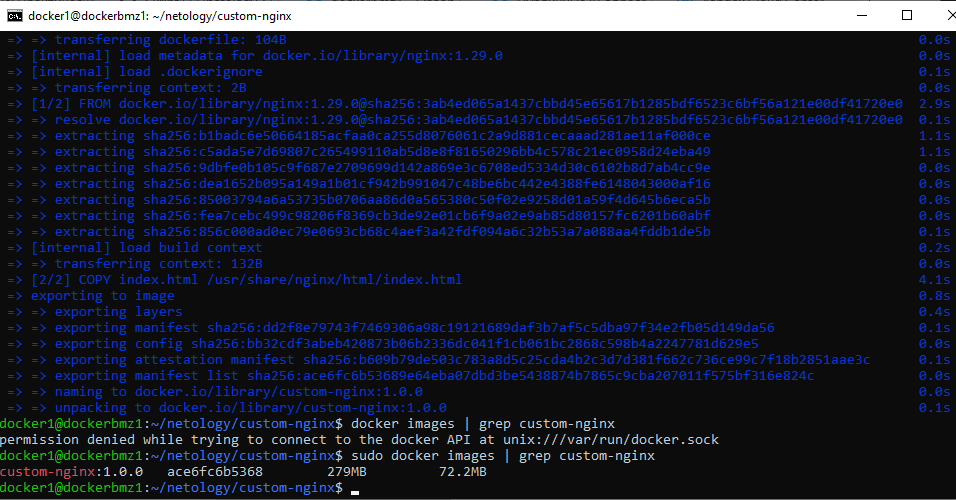
  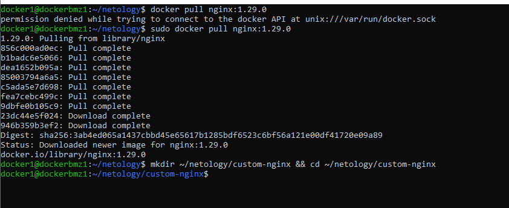
  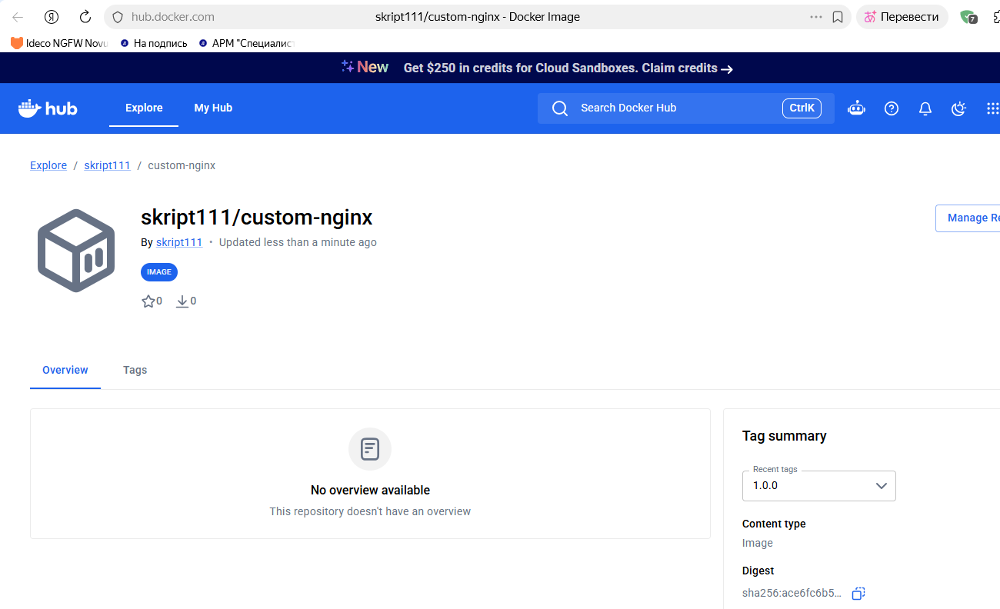
 Ссылка на докер хаб - [Ссылка](https://hub.docker.com/r/skript111/custom-nginx)

## Задание 2. 
  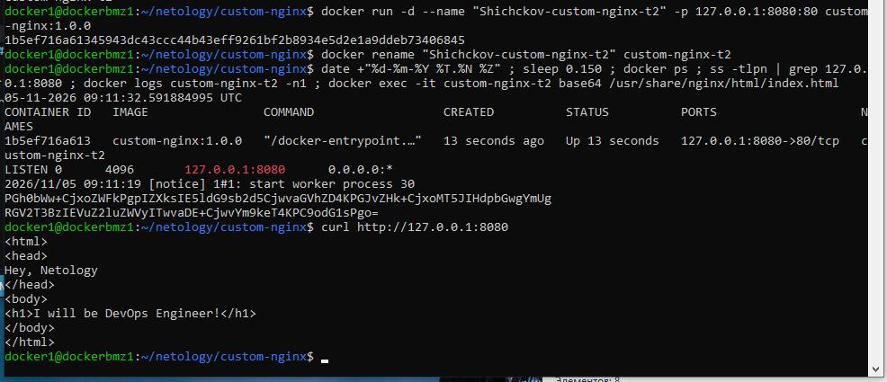

## Задание 3.
  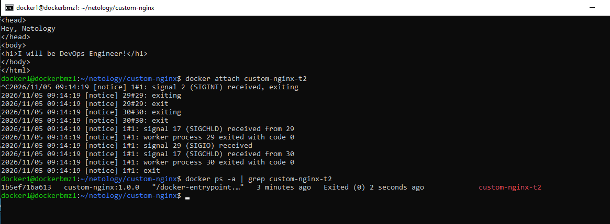
  
  Завершился потому что команда docker attach подключила меня напрямую к потокам ввода/вывода главного процесса , который уже работает , я нажал Ctrl+C отправив тем самым сигнал SIGINT, так как главный процесс умер , Докер автоматом завершил и сам контейнер.
    Меняю порт после перезапуска контейнера.
   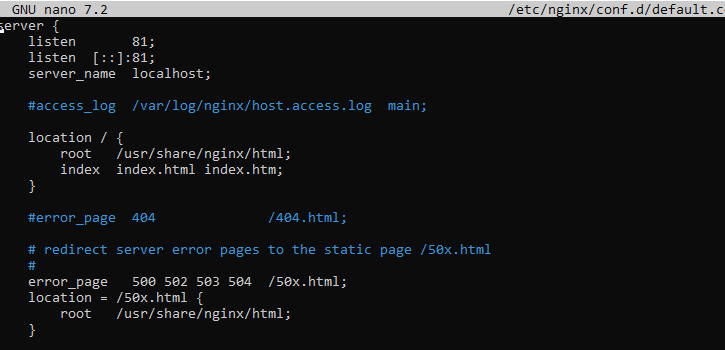
   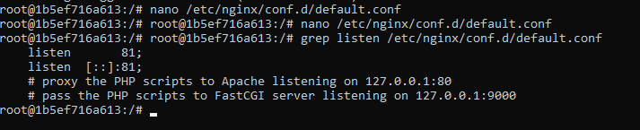
   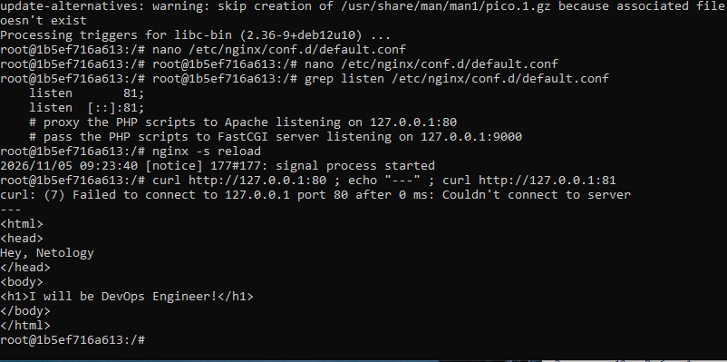
   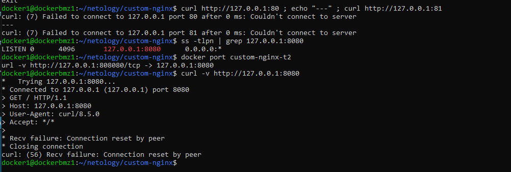
   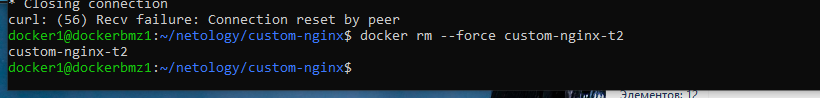
  
   Проброс портов -p 127.0.0.1:8080:80 задается при создании контейнера. Я изменил порт nginx внутри на 81, но Docker по-прежнему перенаправляет запросы с 8080 на 80-й порт контейнера. Так как там теперь пусто, curl выдает ошибку. Изменить проброс можно только пересоздав контейнер

## Задание 4.
    Установка CentOS Debka
   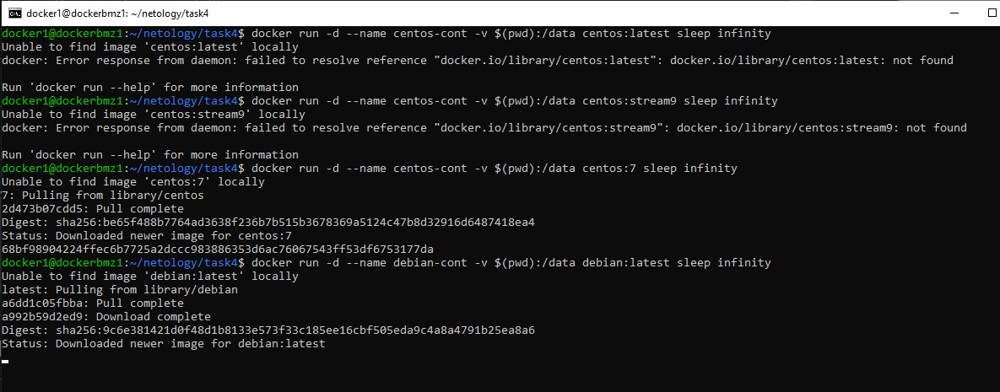
   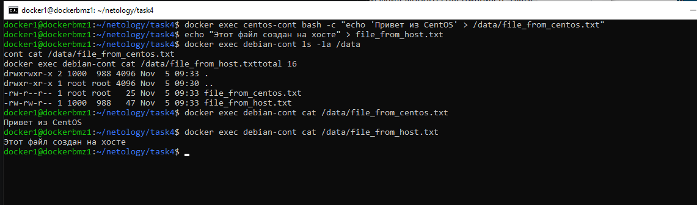
   

## Задание 5.
   Создаю два yaml файла 
 **compose.yaml:**
```yaml
version: "3"
services:
  portainer:
    network_mode: host
    image: portainer/portainer-ce:latest
    volumes:
      - /var/run/docker.sock:/var/run/docker.sock
```
 **docker-compose.yaml:**
```yaml
version: "3"
services:
  registry:
    image: registry:2
    ports:
    - "5000:5000"
```

   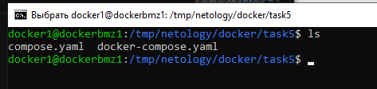
   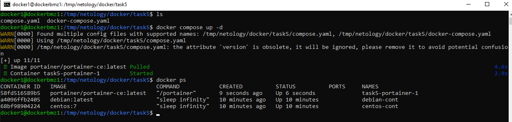

   Видим что запустился ток один , потому что современный Docker Compose отдает приоритет этому имени файла (а docker-compose.yaml считается устаревшим) 
   Перепишим yaml - добавим туда 
  ```
   include:
  - docker-compose.yaml
  ```
  и запустим по новой.
   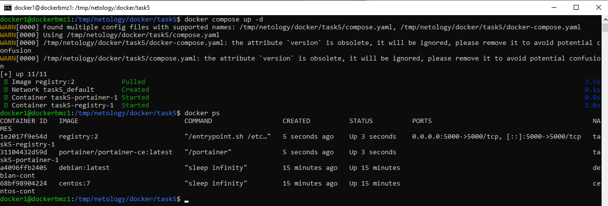
   Создание тега , заливка образа 
   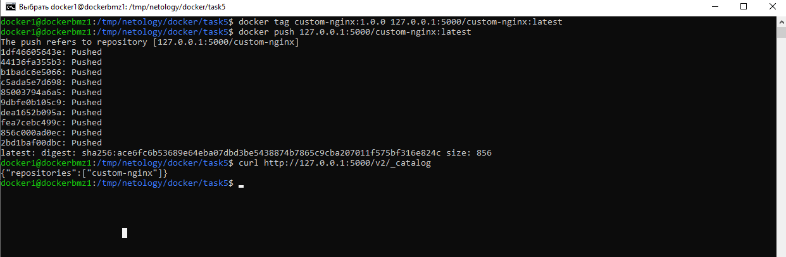
   Настраиваю
   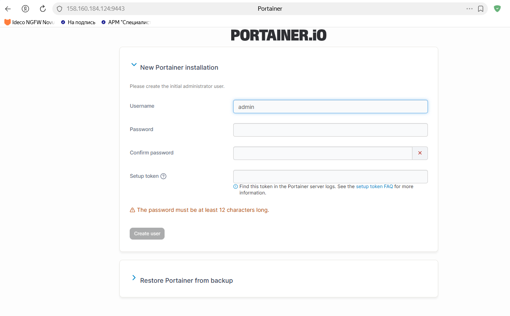

   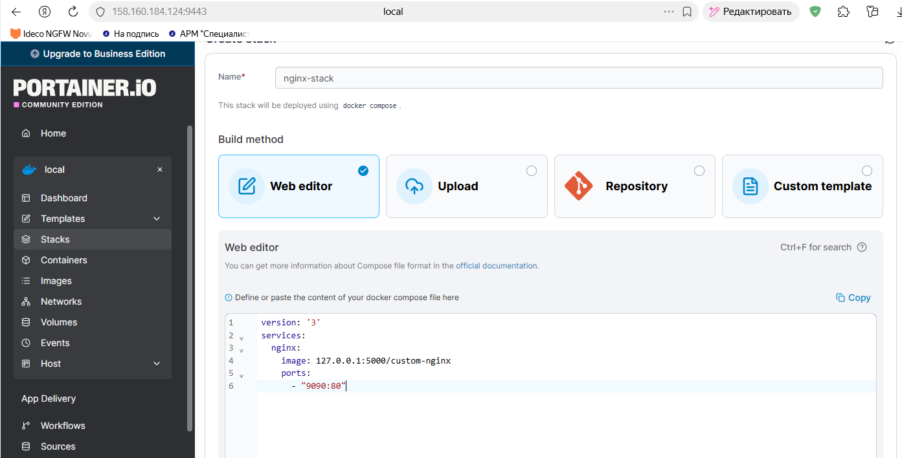

   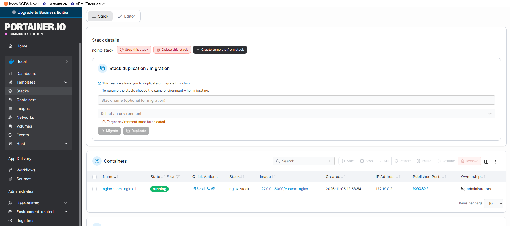

   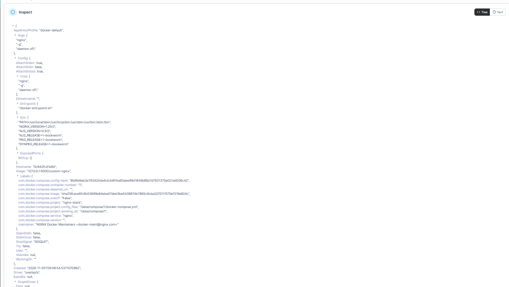

   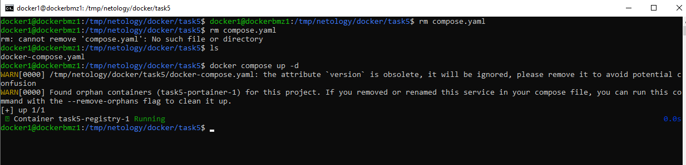

   из-за удаления файла compose.yaml Compose перестал видеть сервис Portainer. Контейнер остался работать, но стал сиротой, так как его нет в текущем конфиге
    Удалем осиротевший контейнер 
    docker compose up -d --remove-orphans
    и гасим одной командой - 
    docker compose down

   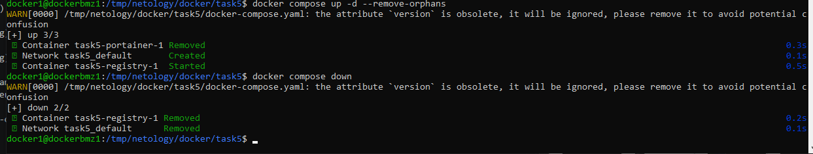


